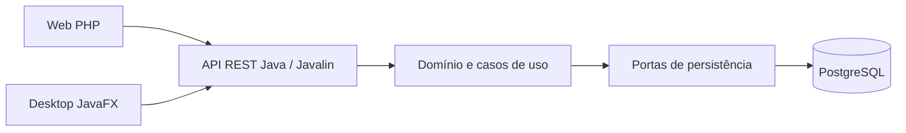

# Sistema de Gestão de Eventos — POO2

Aplicação de gestão de eventos com API REST Java/Javalin, interface web PHP e cliente desktop independente JavaFX. Os dois clientes usam a mesma API e o mesmo banco PostgreSQL.

## Arquitetura



O núcleo segue arquitetura hexagonal: controllers traduzem HTTP para portas de entrada, serviços aplicam regras de negócio e adaptadores PostgreSQL persistem os dados. A aplicação desktop é um cliente JavaFX independente que consome a mesma API; ela não abre uma conexão JDBC própria.

## Requisitos para executar

- JDK 17
- Maven 3.9 ou superior
- Docker Desktop com Docker Compose
- PHP 8 com extensões `curl` e `json` para a interface web

## Configuração local

1. Copie `.env.example` para `.env` na raiz do repositório.
2. Preencha `EVENTOS_AUTH_SECRET` e `EVENTOS_QR_SECRET` com valores aleatórios diferentes, cada um com pelo menos 32 bytes.
3. Preencha `EVENTOS_ADMIN_EMAIL` e `EVENTOS_ADMIN_PASSWORD`. A senha inicial precisa conter ao menos oito caracteres, maiúscula, minúscula, número e um dos símbolos `!@#&*`.
4. Ajuste `EVENTOS_DB_USER` e `EVENTOS_DB_PASSWORD` se desejar trocar as credenciais locais do PostgreSQL.

Exemplo para gerar dois segredos no PowerShell:

```powershell
$bytes = New-Object byte[] 48
$rng = [Security.Cryptography.RandomNumberGenerator]::Create()
$rng.GetBytes($bytes)
[Convert]::ToBase64String($bytes)
$rng.Dispose()
```

Gere o valor duas vezes e coloque os resultados em `EVENTOS_AUTH_SECRET` e `EVENTOS_QR_SECRET`. O `.env` é ignorado pelo Git. Não envie senhas ou chaves para o repositório.

## PostgreSQL

Com o Docker Desktop aberto, execute na raiz do projeto:

```powershell
docker compose up -d --wait postgres
```

O banco começa vazio. Ao iniciar a API, as migrações versionadas em `src/main/resources/db/migration/postgresql` criam o esquema automaticamente. O volume `eventos_postgres_data` mantém os dados quando o container é parado ou recriado.

Para verificar o container:

```powershell
docker compose ps
docker compose logs postgres
```

## Executar a API

Na raiz do repositório:

```powershell
mvn clean compile
mvn exec:java
```

A API fica em `http://localhost:8080`. Se as variáveis do administrador inicial forem configuradas, ele é criado somente quando ainda não existe uma conta `ADMINISTRADOR`. Usuários novos são cadastrados como `USUARIO` e podem criar seus próprios eventos.

Para executar os testes unitários definidos em `src/test/java`:

```powershell
mvn test
```

## Executar a interface web

Em outro terminal:

```powershell
cd frontend
php -S 127.0.0.1:3000
```

Abra `http://127.0.0.1:3000`. O PHP conversa com a API pelo cURL. Por padrão a URL é `http://localhost:8080`; para alterá-la, defina `EVENTOS_API_URL` no ambiente do processo PHP.

## Executar o cliente desktop

Com a API e o PostgreSQL em execução, rode na raiz do projeto:

```powershell
mvn javafx:run
```

O cliente JavaFX oferece login/cadastro, busca de eventos e programação, inscrição e seleção de atividades, exibição do QR único, leitor de imagem QR, registro de frequência, avaliações, gestão de programação, locais e exportação CSV. O endereço da API pode ser definido por `EVENTOS_API_URL` no ambiente ou no `.env`.

## Fluxos principais

1. O participante cria uma conta, abre um evento publicado e se inscreve no evento.
2. Depois da inscrição, escolhe as atividades. A API impede sobreposição de horário e controla as vagas simultaneamente no banco.
3. A inscrição do evento emite um QR assinado que vale para as atividades escolhidas até o fim do evento, conforme o fuso configurado.
4. O organizador seleciona a atividade no leitor e registra check-in único, entrada/saída ou validação manual, conforme a política definida para aquela atividade. Cada registro inclui horário, origem e responsável.
5. O evento pode exigir 50%, 75% ou 100% de presença. A proporção considera os minutos das atividades escolhidas e validadas. Depois do fim do evento, participantes elegíveis podem baixar o certificado PDF; organizadores também podem emitir certificados de palestrante e apresentador com a carga horária das atividades vinculadas.
6. Organizadores publicam avaliações textuais, de escolha única ou escala numérica. A API só aceita resposta de participante inscrito com frequência validada e protege respostas duplicadas.
7. Administradores e organizadores exportam relatórios CSV de inscrições e frequência. Resultados de avaliações também podem ser exportados; questionários anônimos não exibem identificação individual.

## API

- `POST /usuarios` e `POST /auth/login`: cadastro e sessão bearer.
- `/eventos` e `/atividades`: eventos, programação, modalidades, critérios de frequência e vagas.
- `/inscricoes/evento`: inscrição no evento, escolha de atividades, cancelamento, QR e frequência para certificado.
- `POST /frequencias/checkin-qr`: registro de presença com QR, atividade, ação e usuário organizador autenticado.
- `/questionarios`, `/questoes` e `/respostas`: configuração e resposta às avaliações.
- `/locais` e `/atividades/{id}/pessoas`: locais e pessoas vinculadas à programação.
- `/relatorios/eventos/{id}/inscricoes.csv` e `/frequencias.csv`: exportações administrativas.
- `GET /inscricoes/evento/{id}/certificado.pdf`: certificado pessoal, após o encerramento e quando elegível.
- `GET /eventos/{idEvento}/pessoas-programacao/{idPessoa}/certificado.pdf?papel=PALESTRANTE`: certificado de palestrante ou apresentador após o encerramento, por um organizador do evento.

As rotas privadas exigem `Authorization: Bearer <token>` e `X-Usuario-Id` correspondente à identidade assinada no token. As autorizações de organizador são validadas na API; controles da tela não substituem as verificações do servidor.

## Banco e evolução

As migrações PostgreSQL são aplicadas em ordem e registradas em `schema_migrations`. Não edite migrações que já tenham sido executadas: crie uma nova versão. A camada de persistência de execução é PostgreSQL; classes SQLite antigas permanecem no histórico do código, mas não são ligadas pelo `Main`.

## Documentação do projeto

- [Arquitetura e decisões](docs/arquitetura-e-decisoes.md)
- [Esquema e migrações](docs/modelo-de-dados.md)
- [Rotas da API e exemplos](docs/api.md)
- [Rastreabilidade e validação dos requisitos](docs/rastreabilidade.md)
