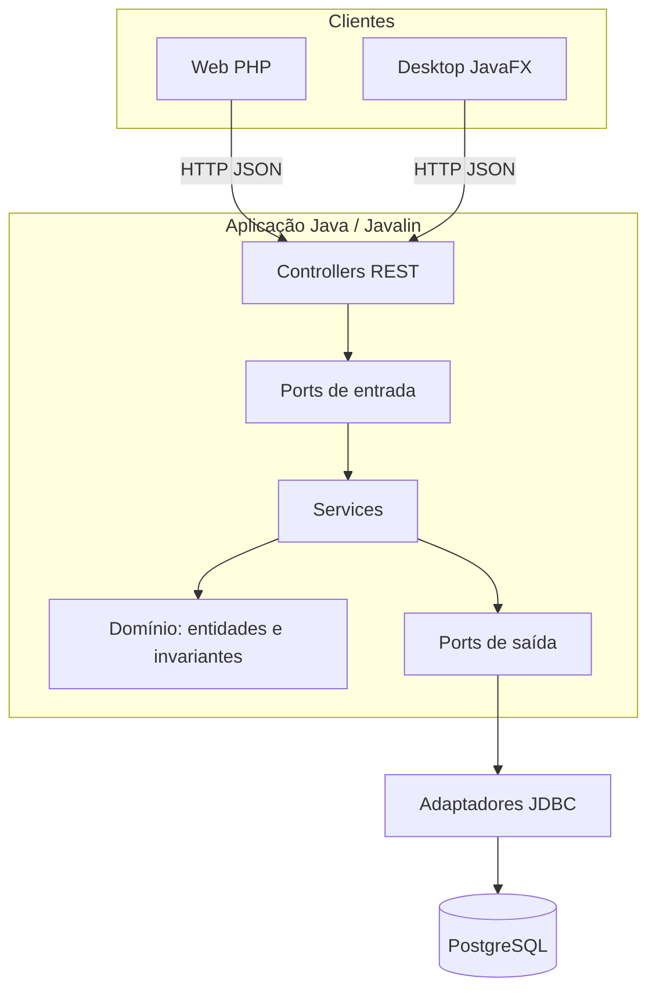

# Arquitetura e decisões

## Visão geral

O PHP e o JavaFX são adaptadores de entrada. Ambos compartilham autenticação, regras de negócio e armazenamento. O JavaFX não acessa diretamente o PostgreSQL, evitando duplicar regras no cliente.

## Decisões de projeto

| ID | Decisão | Motivo e efeito |
|---|---|---|
| D01 | Arquitetura hexagonal | Regras ficam em services e domínio; HTTP e JDBC são adaptadores substituíveis. |
| D02 | PostgreSQL como persistência de execução | Oferece integridade referencial, índices parciais e bloqueio de linhas para controle concorrente de vagas. |
| D03 | PostgreSQL inicia vazio e evolui por migrações | A inicialização registra e executa versões V1–V11; não existe import automático do SQLite. |
| D04 | Clientes consomem a mesma API REST | Evita diferenças de validação entre web e desktop e centraliza autorização. |
| D05 | Sessões bearer assinadas e senhas PBKDF2 | O token carrega identidade e expiração; senhas novas usam salt aleatório e derivação lenta. Hashes SHA-256 antigos são atualizados no próximo login válido. |
| D06 | Um QR assinado por inscrição no evento | O identificador não inclui dados pessoais; o organizador escolhe a atividade na leitura e a API confirma a inscrição naquela atividade. |
| D07 | Critério de frequência pertence à atividade | CHECKIN, ENTRADA_SAIDA e MANUAL têm validações específicas e registros auditáveis. |
| D08 | Frequência e carga horária do certificado são configuráveis por evento | A elegibilidade pode exigir 50%, 75%, 100% ou uma quantidade mínima de horas. A carga impressa pode ser fixa ou somar a presença validada. O cálculo divide a programação pelos limites de início/fim: cada trecho do evento conta uma vez, horários distintos se somam e o participante recebe crédito nos trechos cobertos por atividades escolhidas com presença validada. |
| D09 | A equipe tem autorização delimitada por atividade | Administrador e organizador gerenciam presenças; o organizador vincula colaboradores a atividades específicas. Colaboradores podem registrar presença pelo método configurado, mas não marcar ausência nem corrigir status. |
| D10 | Check-in aceita QR ou busca por nome/CPF conforme decisão do organizador | Cada atividade guarda o método de identificação. A busca usa apenas inscritos ativos que escolheram a atividade e exibe CPF mascarado; CPF completo não é retornado nessa consulta. |
| D11 | Marcações usam instantes absolutos | Frequências são persistidas como `TIMESTAMPTZ`; migração V11 interpreta marcações históricas no fuso configurado no evento. O fuso do evento continua sendo usado para validade do QR e exibição de datas locais. |
| D12 | Avaliações exigem inscrição e presença validada | Uma resposta por participante e questão; anonimato remove a identificação das visões/exportações do organizador. |
| D13 | Cancelamento lógico e histórico | Eventos e inscrições mantêm histórico; cancelar uma inscrição antes do prazo libera as vagas selecionadas. |

## Limites atuais

- Certificados de participantes dependem do mínimo de frequência configurado; palestrantes e apresentadores recebem documento de atuação com a carga horária das atividades às quais foram vinculados.
- O leitor JavaFX lê imagem de QR carregada do computador; a câmera ao vivo fica na interface web.
- Mensageria por e-mail e publicação em ambiente remoto precisam de configuração externa e não fazem parte da execução local descrita neste repositório.
